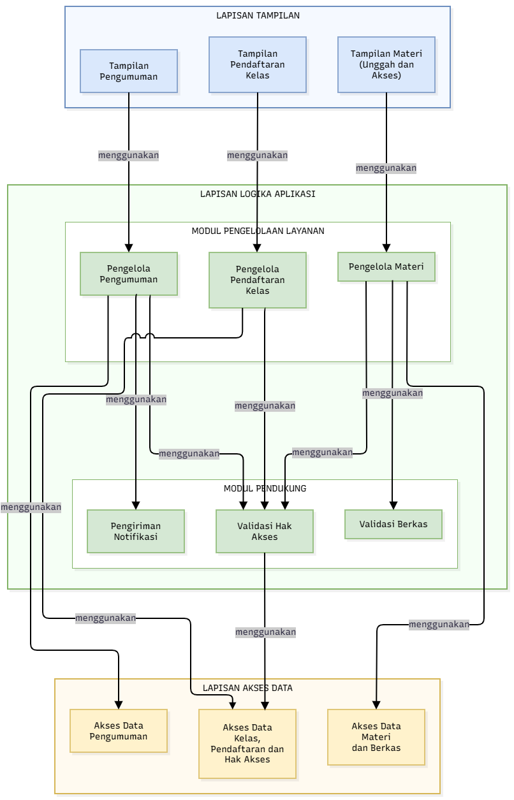
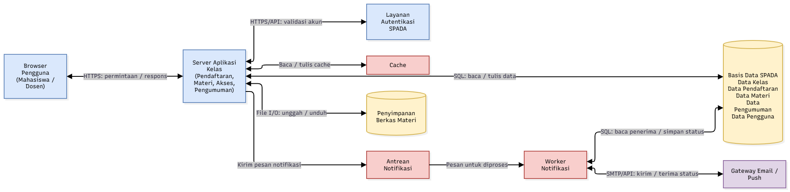
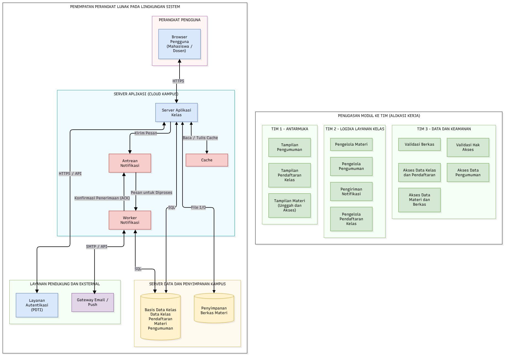

# B3. Tiga Struktur Desain

**Penanggung Jawab:** A. Aqila Nurul Khalida

## B3.1 Struktur Modul (Module Structure)

Struktur modul menggambarkan pembagian kode program ke dalam beberapa modul berdasarkan fungsi dan tanggung jawab masing-masing pada layanan kelas SPADA UMI-Kalam.

---

## B3.2 Struktur Komponen dan Konektor (Component and Connector / C&C)

Struktur komponen dan konektor menggambarkan komponen yang berjalan ketika layanan kelas SPADA UMI-Kalam digunakan serta hubungan komunikasi antarkomponen.

---

## B3.3 Struktur Alokasi (Allocation Structure)

Struktur alokasi menggambarkan penempatan komponen perangkat lunak pada lingkungan sistem serta pembagian tanggung jawab pengembangan kepada masing-masing tim.

